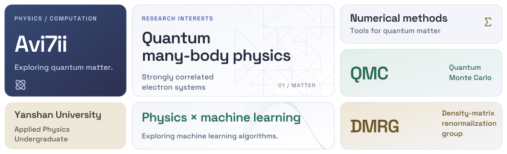

<!-- Compact research profile adapted from OP Bento (GPL-3.0).
     Editable source: design/build.py and design/source/.
     Fonts/icons and licenses: third-party/NOTICE.md. -->

<picture>
  <source media="(max-width: 767px) and (prefers-color-scheme: dark)" srcset="assets/profile-mobile-dark.svg">
  <source media="(max-width: 767px)" srcset="assets/profile-mobile-light.svg">
  <source media="(prefers-color-scheme: dark)" srcset="assets/profile-desktop-dark.svg">
  
</picture>

  
Open-source contributions

  

    <a href="https://github.com/Avi7ii/AirSend">AirSend</a> ·
    <a href="https://github.com/Avi7ii/Zotero-glass">Zotero glass</a> ·
    <a href="https://github.com/Avi7ii/GetBackMyWindows">GetBackMyWindows</a> 
    <a href="https://github.com/Avi7ii?tab=repositories">All repositories ↗</a>
  

